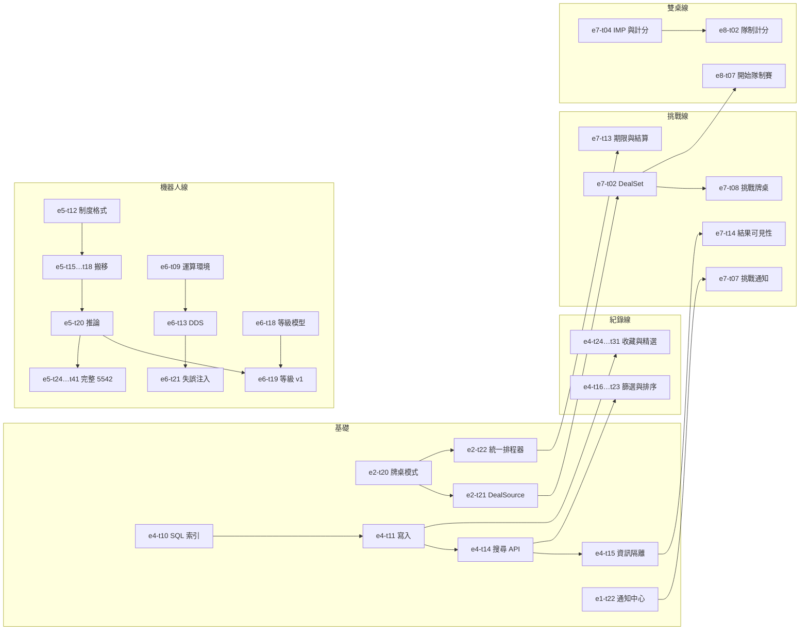

# PRD — 產品需求文件

淡江牌桌的產品需求都在這個資料夾。三層結構：

```
00-prd.md（總 PRD：願景、範圍、F 功能需求、AC 總表、里程碑）
   └─ e1 … e12（每個 epic 一份：背景、目標、AC、task 拆分）
         └─ AC-<epic>.<n>（驗收條件，可勾選）
               └─ e<epic>-t<nn>（task：一個 task ≈ 一個 PR ≈ 1–3 天）
```

| 文件 | 內容 |
| --- | --- |
| [`00-prd.md`](00-prd.md) | 總 PRD：願景、背景、使用者、產品原則、功能地圖、F1–F46、非功能需求、AC 總表、M0–M3 里程碑、指標、風險 |
| [`01-bbo-competitive-analysis.md`](01-bbo-competitive-analysis.md) | BBO 競品分析：功能盤點、GIB／GIBBO 怎麼做、挑戰與隊制賽對照、我們怎麼超越 |
| `e1` … `e12` | 各 epic，見下表 |

## Epic 進度

統計日期 2026-10-24。勾選以各 epic 文件為準，改了勾選順手更新這張表。

| Epic | 名稱 | Task 完成 | AC 完成 | M1 task 數 | 狀態 |
| --- | --- | --- | --- | --- | --- |
| [E1](e1-accounts-identity-community.md) | 帳號、身分與社群 | 19／34 | 4／9 | 13 | in-progress |
| [E2](e2-table-engine-realtime.md) | 牌桌引擎與即時連線 | 24／35 | 8／14 | 12 | in-progress |
| [E3](e3-table-ui-experience.md) | 牌桌介面與體驗 | 27／44 | 7／12 | 13 | in-progress |
| [E4](e4-records-favorites-search.md) | 牌局紀錄、收藏與搜尋 | 15／39 | 3／13 | 24 | in-progress |
| [E5](e5-robot-bidding-brain.md) | 智慧機器人（一）：叫牌制度引擎、2/1 機器人與完整 5542 | 31／63 | 5／14 | 45 | in-progress |
| [E6](e6-robot-play-levels-evaluation.md) | 智慧機器人（二）：打牌大腦、等級與評測 | 19／43 | 4／14 | 15 | in-progress |
| [E7](e7-challenges.md) | 挑戰（單挑與多人） | 7／29 | 0／9 | 25 | in-progress |
| [E8](e8-two-table-team-match.md) | 雙桌隊制賽 | 0／22 | 0／9 | 17 | planned |
| [E9](e9-tournaments-rankings.md) | 比賽、積分與錦標賽 | 0／17 | 0／8 | 0 | planned |
| [E10](e10-practice-teaching.md) | 練習與教學 | 2／14 | 0／9 | 6 | in-progress |
| [E11](e11-platform-ops-scale.md) | 平台、維運、安全與規模 | 7／27 | 3／10 | 8 | in-progress |
| [E12](e12-commercialization.md) | 多社團與商業化 | 0／19 | 0／9 | 0 | planned |
| [E13](e13-community-forum.md) | 社群與論壇 | 0／13 | 0／7 | 0 | planned |
| | **合計** | **111／395** | **32／136** | **178** | |

里程碑分布：M0 95 個（全部完成）、M1 178 個、M2 97 個、M3 25 個。作廢的 task（刪除線）不計入。

## Task 格式

```markdown
- [ ] `e4-t16` 合約篩選 UI：階數＋花色選擇器 … · AC-4.6 · S · ← e4-t14
- [x] `e2-t12` 自動發下一副：拿掉 `ready`、`dealAt` 倒數 … · AC-2.6 · #6
```

| 欄位 | 說明 |
| --- | --- |
| 編號 | `e<epic>-t<nn>`，epic 內的流水號。**不重用、不改號**；作廢的 task 加刪除線並寫原因 |
| 做什麼 | 一句話，看得出 PR 的範圍與驗收方式 |
| 對應 AC | 這個 task 交付哪一條（或哪幾條）AC |
| 大小 | 未完成的 task：`S`（≤ 1 天）或 `M`（1–3 天）。**沒有 L**，超過 3 天就拆 |
| 依賴 | `← e4-t14`：要先合併的 task。只寫真正會卡住的依賴 |
| PR | 已完成的 task：合併的 PR 號（`#6`）或 commit（`af451fa`，第一版沒有 PR） |

規則：

1. **一組相關的 task 一個 PR**（一個 task 一個 PR 是最小單位；相鄰、同一條線的 task 可以合成一個，例如 `e5-t15`～`t18`）。分支名帶第一個 task 編號（例如 `feat/e4-t16-contract-filter`），PR 標題結尾列出全部編號（例如 `feat(records): filter by contract [e4-t16, t17]`），PR 本文寫對應的 AC。
2. **在同一個 PR 勾選**：把自己的 task 從 `[ ]` 改成 `[x]`，大小與依賴換成 PR 號，並更新上面的進度表。
3. **AC 什麼時候勾**：這條 AC 的 task 全部完成，而且有人照 AC 文字實際驗證過（測試或實測寫在 PR）。
4. **發現新工作就加 task**：接在該 epic 最後一個編號之後，放到正確的里程碑區段，不要塞進正在做的 PR。
5. M0 的 task 是事後從 `af451fa` 與 PR #1–#12 拆出來的，所以一個 PR 會對應好幾個 task；之後一律一個 task 一個 PR。

里程碑：**M0** 社團 MVP（已上線）、**M1** 社團完整版、**M2** 公開測試、**M3** 商業化（`00-prd.md` §11）。同一個 epic 內，M1 的 task 不依賴 M2 以後的 task。

## M1 建議順序

M1 的四大功能（收藏／精選／篩選、聰明的機器人、挑戰、雙桌隊制賽）共用三個基礎，先做基礎再平行開四條線：



| 波次 | 內容 | 可以平行 |
| --- | --- | --- |
| 第 1 波 | 基礎：`e2-t20`–`t22`、`e4-t10`–`t15`、`e1-t22`；不依賴別人的純函式：`e7-t04`、`e10-t01`、`e5-t12`–`t14`、`e5-t39`；決策紀錄：`e6-t09` | 全部 |
| 第 2 波 | 四條線：紀錄（E4）、挑戰（E7）、雙桌（E8，等 `e7-t02`、`e7-t04`）、機器人（E5 搬移與推論、E6 DDS、評測、等級） | 四條線之間 |
| 第 3 波 | 補齊體驗：E1 好友與私訊、E3 二次確認與鍵盤、E10 練習桌與叫牌提示卡、E11 日誌與備份、E5 完整 5542 與題庫擴充 | 全部 |

## 怎麼新增一個 epic

1. 檔名 `e<n>-<英文-slug>.md`，frontmatter 照現有 epic（`title`、`date`、`status`、`epic`、`owner`、`milestones`、`depends_on`）。
2. 章節：背景、目標、非目標、需求、設計方向、驗收條件、Task 拆分、風險與對策、未決問題。
3. 在 `00-prd.md` 的功能地圖（§6）、功能需求（§8.2）與 AC 總表（§10）加上它，並更新本頁的進度表。
